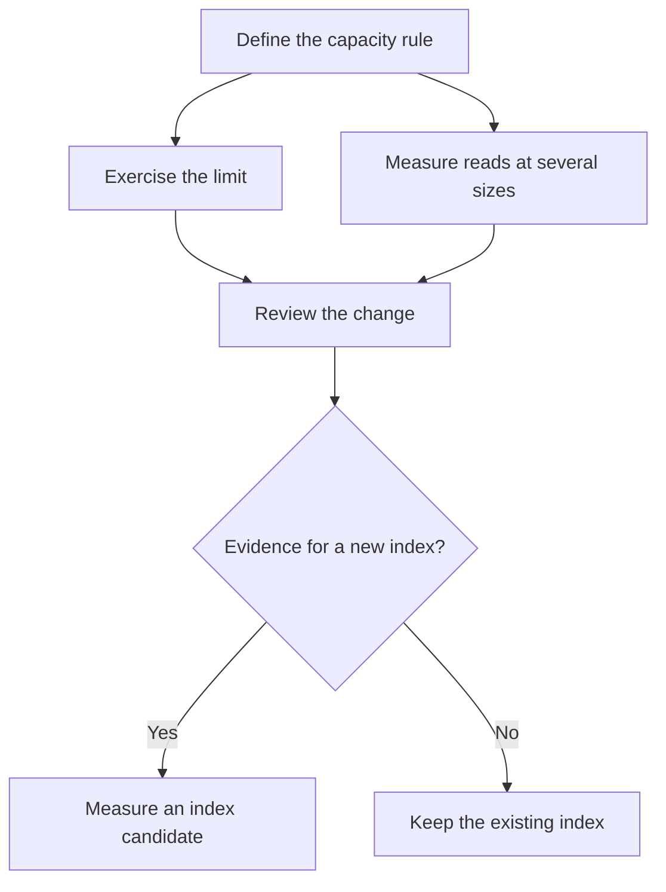

# Glamour Acessórios · Catalog capacity and performance

[Português](README.md) · **English**

I developed a digital catalog with a cart, WhatsApp ordering, and product management through **07Dev**. This case explains how I investigated catalog expansion: verify the counting rule, measure reads at different dataset sizes, and use query plans to decide whether index changes were warranted.

| | |
| --- | --- |
| **My role** | Full-stack development, catalog rules, capacity analysis, and validation |
| **Project technologies** | Next.js, TypeScript, and PostgreSQL through Supabase |
| **Interview topic** | Concurrent catalog capacity, store isolation, and interpreting p95 |

The historical local PostgreSQL benchmark included a scenario with **1,800 active test products**. The [validation notes](docs/en/validation.md) present aggregate measurements and identify the environment and scope of each result.

- [Architecture](docs/en/architecture.md)
- [Technical decisions](docs/en/decisions.md)
- [Validation and interview walkthrough](docs/en/validation.md)

**Local demo.** Run `node --test example/catalog-capacity.test.mjs` with Node.js 24 and zero external dependencies. The example uses synthetic data to illustrate the capacity rule in memory.

**Luís Felipe Guimarães Isaías Carneiro** · [GitHub](https://github.com/luisfecarneiro-dev) · [Authorship notice](NOTICE.md)
