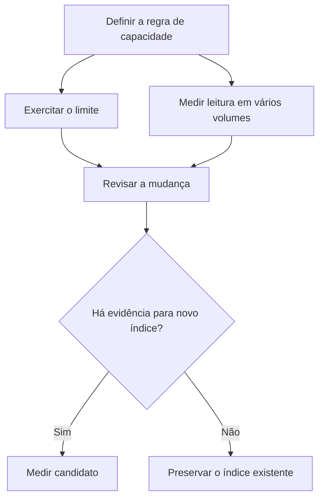

# Glamour Acessórios · Capacidade e desempenho de catálogo

**Português** · [English](README.en.md)

Desenvolvi pela **07Dev** um catálogo digital com carrinho, pedido via WhatsApp e gestão de produtos. Neste caso, explico como investiguei a expansão da capacidade do catálogo: conferir a regra de contagem, medir a leitura em diferentes volumes e usar o plano de execução para decidir se valia alterar os índices.

| | |
| --- | --- |
| **Meu papel** | Desenvolvimento full stack, regras de catálogo, análise de capacidade e validação |
| **Tecnologias do projeto** | Next.js, TypeScript e PostgreSQL via Supabase |
| **Tema para entrevista** | Limite concorrente de catálogo, isolamento por loja e interpretação de p95 |

O ensaio histórico em PostgreSQL local incluiu um cenário com **1.800 produtos ativos de teste**. A [validação](docs/pt-br/validation.md) apresenta medições agregadas e identifica o ambiente e o alcance de cada resultado.

- [Arquitetura](docs/pt-br/architecture.md)
- [Decisões técnicas](docs/pt-br/decisions.md)
- [Validação e roteiro de entrevista](docs/pt-br/validation.md)

**Demonstração local.** `node --test example/catalog-capacity.test.mjs`, com Node.js 24 e zero dependências externas. O exemplo usa dados sintéticos e ilustra a regra de capacidade em memória.

**Luís Felipe Guimarães Isaías Carneiro** · [GitHub](https://github.com/luisfecarneiro-dev) · [Aviso de autoria](NOTICE.md)
