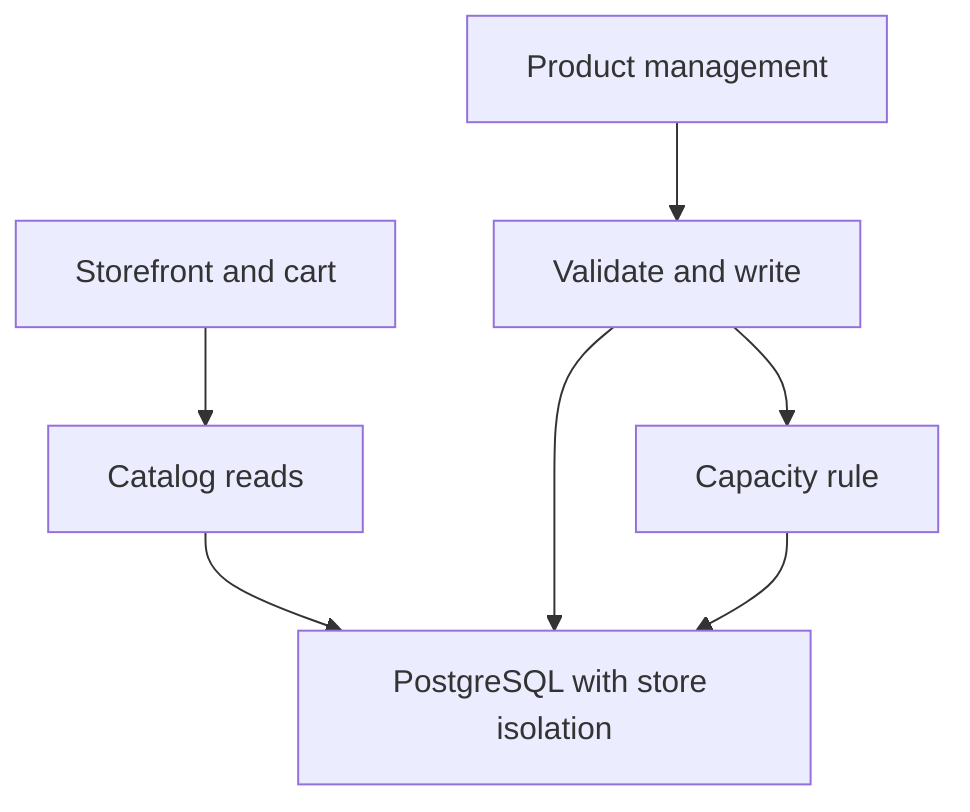

# Architecture

[Português](../pt-br/architecture.md) · [English](../../README.en.md)

The system has two main journeys. Shoppers browse the catalog, manage a cart, and start a conversation through WhatsApp. Staff maintain the catalog. The journeys share a relational database and have different authorization boundaries. PostgreSQL row-level security (RLS) scopes data access by context.

## Business rule

In this study, a product takes one slot when it is active and available in the catalog. Capacity belongs to the store. Optional integration and merchandising fields are independent of this rule. Publishing and restoring a product can both increase the count. Repeating an update that keeps the product active should preserve the count.

The [in-memory example](../../example/catalog-capacity.mjs) models whether to accept or reject the next update. In a shared database, counting and writing require atomic coordination within the store to handle concurrent activations. The simulation models the rule within a single execution.
