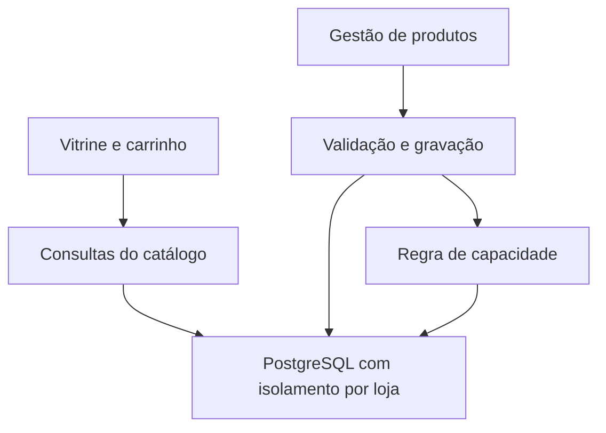

# Arquitetura

[Português](../../README.md) · [English](../en/architecture.md)

O sistema tem duas jornadas principais. Quem compra consulta catálogo, gerencia o carrinho e inicia o atendimento por WhatsApp. Quem administra mantém o catálogo. As duas jornadas compartilham a base relacional e têm fronteiras diferentes de autorização. No PostgreSQL, políticas por linha (RLS) delimitam o acesso por contexto.

## Regra de negócio

Neste estudo, um produto ocupa uma vaga quando está ativo e disponível no catálogo. O limite é uma propriedade da loja. Campos opcionais de integração e merchandising são independentes dessa regra. A operação de publicar e a de restaurar um produto podem aumentar a contagem. Uma atualização repetida que mantém o produto ativo deve preservar a contagem.

O [exemplo em memória](../../example/catalog-capacity.mjs) contempla a decisão de aceitar ou recusar uma próxima atualização. Em um banco compartilhado, verificar a contagem e atualizar o registro exigem coordenação atômica no escopo da loja para lidar com duas ativações concorrentes. A simulação representa a regra em uma única execução.
